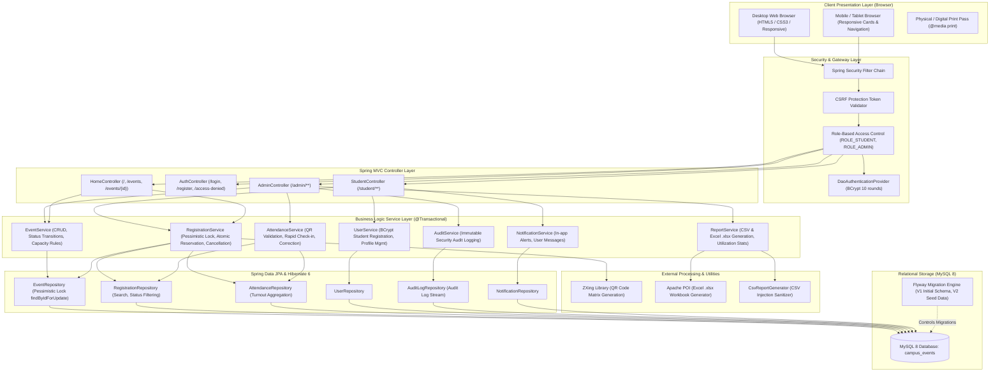
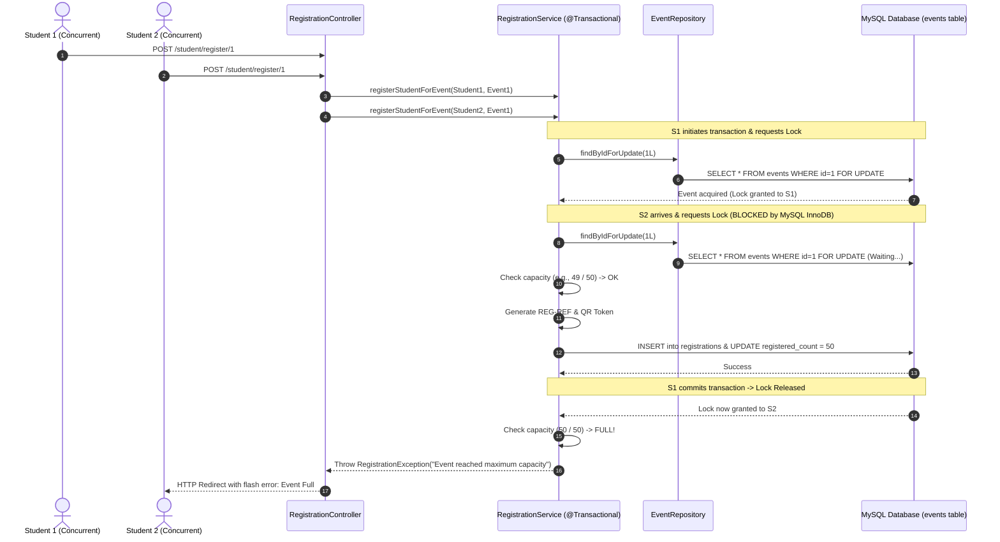
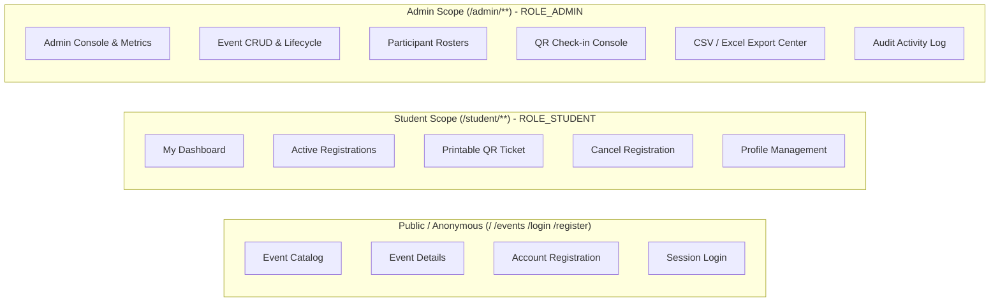

# System Architecture & Technical Design

## 1. High-Level Architectural Overview

The **Campus Event Registration System** is engineered as a robust, layered, server-side rendered enterprise web application built on **Java 17**, **Spring Boot 3.2.5**, **Spring MVC**, **Spring Data JPA / Hibernate 6**, **Spring Security 6**, and **MySQL 8.0**.

The application adheres to clean architecture principles with clear separation of concerns across presentation, security, application business logic, persistence, and external reporting utilities.

---

## 2. Concurrency Model & Pessimistic Locking

To strictly eliminate race conditions, duplicate bookings, and overbooking when multiple students attempt to register simultaneously for the final seat in a high-demand event, the application utilizes database-level **Pessimistic Locking**:

---

## 3. Security Architecture & Role Isolation

- **Role Protection**: Server-side enforcement with `hasRole('ADMIN')` and `hasRole('STUDENT')`.
- **Ownership Verification**: Before displaying or cancelling a ticket, `registration.getStudent().getId().equals(currentUser.getId())` is verified on the backend.
- **CSRF Tokens**: All state-modifying requests (`POST`) require a cryptographically valid CSRF token.
- **Password Hashing**: BCrypt with strength factor 10.

