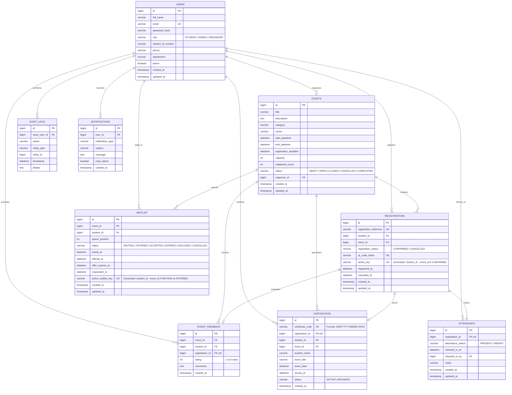

# Database Entity-Relationship (ER) Design

## 1. Relational Entity Diagram



---

## 2. Table Specifications & Integrity Rules

### `users` Table
Stores authentication credentials, contact information, and role authorizations.
- **Primary Key**: `id` (BIGINT AUTO_INCREMENT)
- **Unique Constraints**: `email` (Unique college email address)
- **Indexes**: `idx_users_email`, `idx_users_role`
- **Security Rule**: The `role` column accepts `STUDENT`, `ADMIN`, or `ORGANIZER`. Public signups can only ever populate `STUDENT`.

### `events` Table
Stores campus event listings, scheduling constraints, capacity quotas, and lifecycle states.
- **Primary Key**: `id` (BIGINT AUTO_INCREMENT)
- **Foreign Key**: `organizer_id` -> `users(id)`
- **Indexes**: `idx_events_status`, `idx_events_category`, `idx_events_start_datetime`, `idx_events_deadline`
- **Status Lifecycle**: `DRAFT` &rarr; `OPEN` &rarr; `CLOSED` / `CANCELLED` &rarr; `COMPLETED`.

### `registrations` Table
Tracks ticket issuances, student reservations, and status (`CONFIRMED` or `CANCELLED`).
- **Primary Key**: `id` (BIGINT AUTO_INCREMENT)
- **Unique Constraints**:
  - `registration_reference`: Human-readable identifier (e.g., `REG-20261029-71A89B`)
  - `qr_code_token`: Opaque UUID string encoded into ticket QR codes
  - `active_key`: Generated STORED column:
    ```sql
    CASE WHEN registration_status = 'CONFIRMED' THEN CONCAT(student_id, '-', event_id) ELSE NULL END
    ```
- **Foreign Keys**:
  - `student_id` -> `users(id)`
  - `event_id` -> `events(id)`

### `attendance` Table
Records participant verification at the venue registration desk.
- **Primary Key**: `id` (BIGINT AUTO_INCREMENT)
- **Unique Constraint**: `registration_id` (1:1 with registration)
- **Foreign Keys**:
  - `registration_id` -> `registrations(id)`
  - `checked_in_by` -> `users(id)` (Staff member performing check-in)
- **Status**: `PRESENT` or `ABSENT`.

### `waitlist` Table (Enhancement A)
Maintains FIFO waitlist positions for events at maximum capacity.
- **Primary Key**: `id` (BIGINT AUTO_INCREMENT)
- **Generated Key Constraint**: `active_waitlist_key`:
  ```sql
  CASE WHEN status IN ('WAITING', 'OFFERED') THEN CONCAT(student_id, '-', event_id) ELSE NULL END
  ```
  Guarantees zero duplicate active waitlist entries per student per event.
- **Indexes**: `(event_id, status)`, `(event_id, queue_position)`, `(student_id)`.

### `certificates` Table (Enhancement E)
Stores participation credentials issued strictly to verified attendees (`PRESENT`).
- **Primary Key**: `id` (BIGINT AUTO_INCREMENT)
- **Unique Constraints**:
  - `certificate_code`: Verifiable public code (`CERT-YYYYMMDD-XXXX`)
  - `registration_id`: 1 certificate per registration
- **Indexes**: `idx_cert_code`, `idx_cert_student`, `idx_cert_event`.

### `event_feedback` Table (Enhancement H)
Stores verified participant ratings (1–5 stars) and critiques.
- **Unique Constraints**:
  - `registration_id` (1 review per registration)
  - `uq_student_event_feedback`: `(student_id, event_id)` (1 review per student per event).
- **Indexes**: `idx_feedback_event`, `idx_feedback_rating`.
