# Use-Case Specifications & Actor Workflows

## 1. Use-Case Diagram

```mermaid
graph TD
    %% Actors
    Visitor["Anonymous Visitor"]
    Student["Student (Authenticated)"]
    Admin["Campus Administrator"]

    %% Visitor Use Cases
    UC_Browse["Browse Campus Events"]
    UC_Search["Search & Filter by Category/Venue/Date"]
    UC_ViewDetails["View Event Details & Available Seats"]
    UC_RegisterAccount["Register Student Account"]
    UC_Login["Log In to Account"]

    %% Student Use Cases
    UC_BookEvent["Register / Reserve Seat for Event"]
    UC_ViewDashboard["Access Student Dashboard"]
    UC_ViewTicket["View & Print Digital QR Ticket"]
    UC_DownloadQR["Download Ticket QR Image (PNG)"]
    UC_CancelReg["Cancel Eligible Registration"]
    UC_ViewHistory["View Past Event Attendance History"]
    UC_UpdateProfile["Update Student Profile"]

    %% Admin Use Cases
    UC_AdminDash["Access Admin Metrics & Analytics"]
    UC_CreateEvent["Create New Campus Event"]
    UC_EditEvent["Edit Existing Event & Quota"]
    UC_ChangeStatus["Publish, Close, or Cancel Event"]
    UC_ManageParticipants["Search & Filter Participants Roster"]
    UC_ScanCheckIn["Check In Attendee (QR Scan / Reference ID)"]
    UC_ToggleAttendance["Reverse / Correct Attendance"]
    UC_ExportReports["Export CSV & Excel (.xlsx) Reports"]
    UC_ViewAudit["Review Security Audit Logs"]

    %% Connections
    Visitor --> UC_Browse
    Visitor --> UC_Search
    Visitor --> UC_ViewDetails
    Visitor --> UC_RegisterAccount
    Visitor --> UC_Login

    Student --> UC_Login
    Student --> UC_BookEvent
    Student --> UC_ViewDashboard
    Student --> UC_ViewTicket
    Student --> UC_DownloadQR
    Student --> UC_CancelReg
    Student --> UC_ViewHistory
    Student --> UC_UpdateProfile

    Admin --> UC_Login
    Admin --> UC_AdminDash
    Admin --> UC_CreateEvent
    Admin --> UC_EditEvent
    Admin --> UC_ChangeStatus
    Admin --> UC_ManageParticipants
    Admin --> UC_ScanCheckIn
    Admin --> UC_ToggleAttendance
    Admin --> UC_ExportReports
    Admin --> UC_ViewAudit
```

---

## 2. Core Workflow Specifications

### UC-1: Student Event Registration
- **Actor**: Student (ROLE_STUDENT)
- **Preconditions**:
  1. Student is authenticated with an active session.
  2. Target event status is `OPEN`.
  3. Current timestamp is prior to the event's registration deadline and start time.
  4. Event has available capacity (`registered_count < capacity`).
  5. Student does not already possess a `CONFIRMED` registration for this event.
- **Main Success Scenario**:
  1. Student clicks "Confirm Registration" on event details page.
  2. Spring Security validates CSRF token and `ROLE_STUDENT` authority.
  3. `RegistrationService` acquires a pessimistic write lock on the target event record in MySQL.
  4. The system validates all preconditions under the database lock.
  5. A unique human-readable registration reference (`REG-YYYYMMDD-XXXXXX`) and opaque UUID token are generated.
  6. A registration record with status `CONFIRMED` and an associated attendance record with status `ABSENT` are inserted.
  7. Event `registered_count` is incremented by 1.
  8. An in-app confirmation notification and security audit log entry are created.
  9. Student is redirected to their digital QR ticket page.
- **Alternative Flow - Capacity Exhausted**:
  - If another concurrent student booked the final seat while the page was loaded, the service catches the condition and throws `RegistrationException`. The transaction rolls back cleanly, and the student is informed with a friendly message that the event is full.

### UC-2: Event Desk Check-In via QR Code / Reference
- **Actor**: Administrator (ROLE_ADMIN)
- **Preconditions**: Administrator is logged into the Admin Console.
- **Main Success Scenario**:
  1. Desk administrator opens `/admin/attendance/{eventId}`.
  2. Administrator scans participant's QR code (or types registration reference into check-in input).
  3. System looks up the registration by reference or token.
  4. System verifies that registration status is `CONFIRMED`.
  5. System records `checked_in_at = NOW()`, `checked_in_by = admin.id`, and updates attendance status to `PRESENT`.
  6. Student receives an in-app confirmation that attendance was recorded.
  7. Turnout statistics and attendance percentage refresh automatically.
- **Correction Scenario**:
  - If marked by mistake, the administrator clicks "Mark Absent" in the roster to cleanly reverse the check-in status.

### UC-3: Report Generation & Export
- **Actor**: Administrator (ROLE_ADMIN)
- **Main Success Scenario**:
  1. Administrator visits `/admin/reports`.
  2. Clicks "Download CSV" or "Download Excel (.xlsx)" for a specific event or the campus-wide summary.
  3. Backend streams the generated file using Apache POI or safe CSV writer.
  4. All cells with potential spreadsheet formula injection (`=`, `+`, `-`, `@`) are automatically sanitized.

